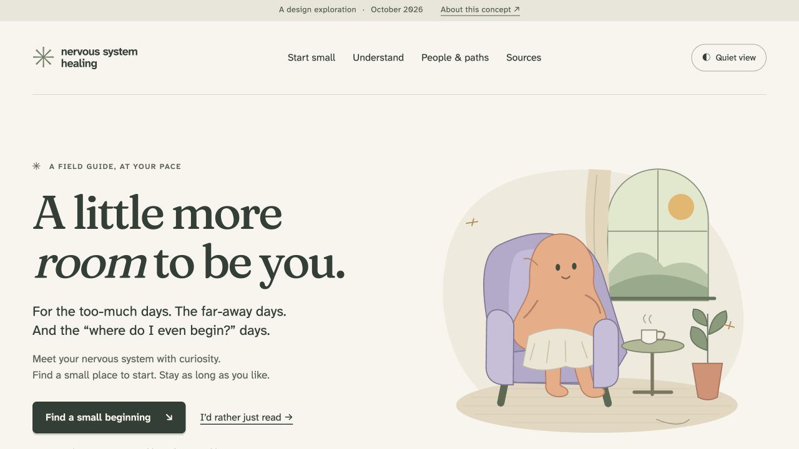

# A little more room — interactive design concept

An independently runnable homepage proposal for [exploration 0010](../../explorations/0010_%5B_%5D_A_LITTLE_MORE_ROOM_NERVOUS_SYSTEM_SITE_REJUVENATION.md). It demonstrates the visual direction, visitor choices, resource annotations, and evidence disclosures. It does not change the Astro application or deploy a website.

Open [index.html](index.html) directly, or run from the repository root:

```sh
python3 -m http.server 4178 --bind 127.0.0.1 --directory docs/concepts/a-little-more-room
```

Then open [the local preview](http://127.0.0.1:4178/). Port 4178 was used for this review; choose another if it is occupied.

## What works

- Four native radio choices reveal invitations based on the reader's explicit request.
- “That's enough for now” / “Done for now” leads to a real ending, with focus moved to its heading. Choosing another beginning returns focus to the selected radio.
- Quiet view removes decorative illustrations and most color fields. Content remains available.
- Native disclosures explain practitioner scope and research limits.
- Existing-site and external resource links have real destinations. New directory/article routes proposed in the brief are not simulated here.
- Without JavaScript, all four invitations and ordinary links remain visible; enhancement-only controls are hidden.

No selections are saved. There are no third-party fonts, embeds, tracking scripts, timers, or animations. Fraunces and Atkinson font files come from the repository's installed packages, with their licenses included. The SVG illustration was authored for this concept.

## Community update

The hero now has separate armrests and continuous legs beneath the blanket.
The footer links to the public [repository](https://github.com/crs48/nervous-system-healing),
its [MIT license](../../../LICENSE) under Christopher Smothers, and
[contribution guidance](../../../CONTRIBUTING.md). The current Astro site's
footer also identifies the project as an open-source community resource;
the full homepage overhaul remains a separate implementation step.

## Review record — October 10, 2026

- [x] Inspect the full desktop page at the default 1280px browser width.
- [x] Inspect narrow layouts at 390px and 320px; document width matches the viewport.
- [x] Exercise all four choices, keyboard arrow navigation, ending, and restart.
- [x] Verify visible keyboard focus and focus destination after ending/restarting.
- [x] Verify quiet view's pressed state and removal of decorative artwork.
- [x] Open a practitioner disclosure and the 2026 trial note.
- [x] Check a temporary copy without the script: four invitations remain visible; enhancement buttons and radio controls are absent. Remove the temporary copy after the check.
- [x] Check JavaScript syntax and browser console: no reported warnings or errors in the final preview.
- [x] Check unique HTML IDs, in-page destinations, and relative document/file references.
- [x] Format HTML, CSS, and JavaScript with the repository's installed Prettier.

These checks are a prototype review, not a WCAG certification or a clinical review. Full screen-reader testing, theme integration, a comprehensive contrast audit, production content review, and Astro route/build verification remain in the implementation checklist. This concept intentionally presents one light-theme visual direction; the production overhaul should preserve and verify the current site's dark theme.

## Captures

- [Desktop welcome](screenshots/desktop.jpg)
- [Full page](screenshots/full-page.jpg)
- [Mobile choice panel with keyboard focus](screenshots/mobile.jpg)
- [Open-source community footer](screenshots/community-footer.jpg)


