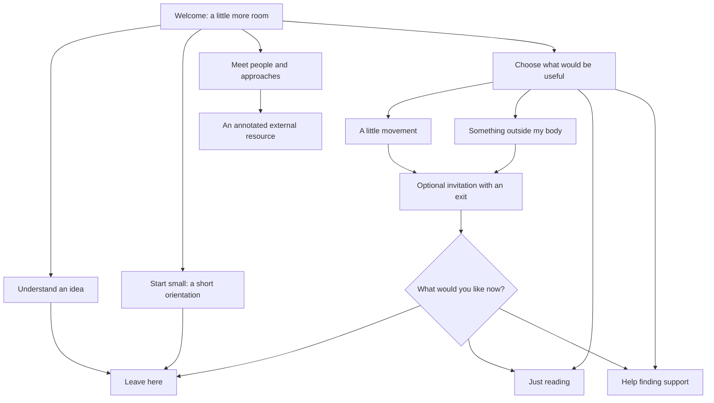
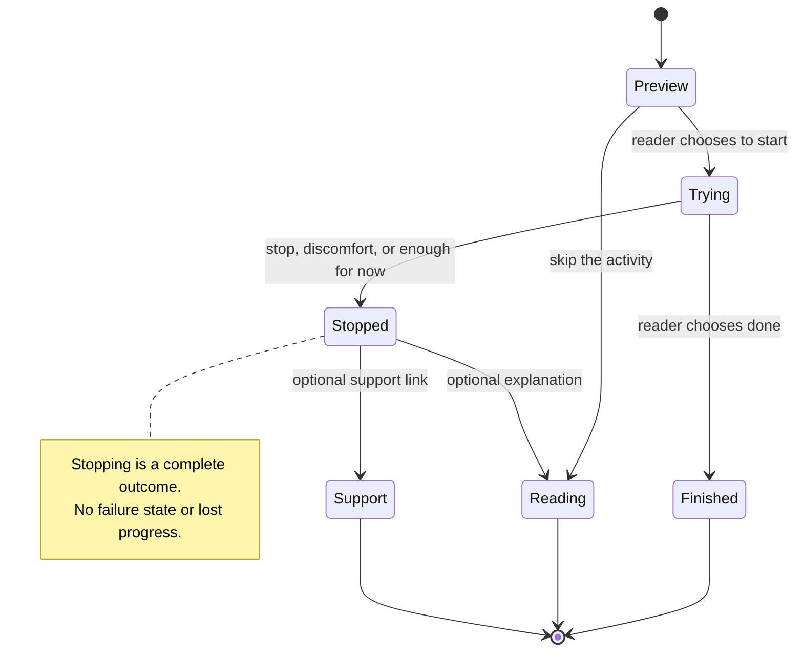
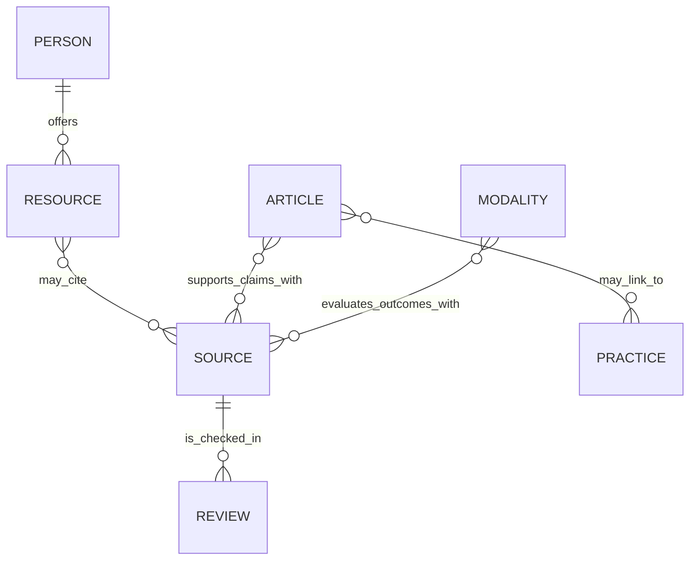

# A little more room 🌿

## Problem statement

Nervous System Healing has a kind, useful foundation, but the experience is quieter than its subject and its author. The homepage offers four abstract destinations. It does not yet give visitors the recognition, curiosity, personal context, or small discovery that makes Chris's newly revised explorations inviting.

The request is to explore an overhaul: learn from the other sites on [crs.land](https://crs.land/), bring in current research and important voices, and create a more playful, compelling starting place for a nervous-system healing journey. The recent [tweet](https://x.com/becomingbabyman/status/2108715333494411314), [Timeout essay](https://xnet.fyi/blog/timeout/), and [coaching site](https://crs.coach/) supply public context.

**Date:** October 10, 2026. **Status:** archived design direction. The illustrated homepage was implemented, then superseded at Chris’s request by a simpler tour-first design across the site. Existing article content and the research resources are preserved; the broader editorial recommendations below remain proposed. The `[_]` filename tracks that remaining work. The companion [research dossier](../research/2026-10-10_NERVOUS_SYSTEM_RESEARCH_AND_PEOPLE.md) records evidence, limitations, and resource choices. The original [interactive concept](../concepts/a-little-more-room/index.html) remains a design reference; the production homepage lives in `src/pages/index.astro`.

## Executive summary

Build **a friendly field guide to having a nervous system**. Its working editorial theme is **“A little more room.”** Keep the existing site name and address initially. Offer a sense of possibility without setting calm, productivity, or a dramatic breakthrough as the required destination.

The overhaul should do six things:

1. **Make the welcome tangible.** An illustrated hero, a clear first step, and a question someone can recognize from their day. Warm serif typography, brighter accent surfaces, and a small amount of affectionate humor connect it to the rest of Chris's work.
2. **Let the reader choose the kind of help.** “Help me understand,” “Something outside my body,” “A little movement,” and “Help finding support” are requests the site can honor. Do not diagnose a state from a slider.
3. **Build around range and agency.** Feeling more can be overwhelming; quiet can mean many things; rest can be useful; support and accommodations belong beside practice. Make stopping an ordinary, complete outcome.
4. **Introduce people through their useful ideas.** Irene Lyon, Joe Hudson, Jonny Miller, and Bessel van der Kolk get annotated ways in. Extend the map with clinicians, researchers, neurodivergent perspectives, and cultural context.
5. **Make research pleasant to inspect.** Short “what we know / what we don't” notes attached to claims. Distinguish clinical evidence, early findings, teaching frameworks, and lived experience.
6. **Keep the technical foundation small.** Astro, Markdown collections, existing fonts, static hosting, and a few progressively enhanced components can carry this. The value is editorial and experiential; a framework migration adds little.

**Recommended first release:** revise risky or overstated copy, rebuild the homepage and beginner route, publish two new situation guides, launch a small annotated people directory, and make evidence notes consistent. Defer biometrics, accounts, daily programs, immersive animation, and a large resource database.

## 1. What the current repository already gives us

### Observed architecture

The checkout begins from `4e119d0` on `main` and was clean. `package.json` declares Astro 7 and Tailwind 4; this exploration does not make a claim about the newest upstream releases. Static deployment uses GitHub Actions and GitHub Pages. `astro.config.mjs` sets the `/nervous-system-healing` base path and trailing slashes.

| Area | Observed implementation | What to do with it |
|---|---|---|
| Homepage | [`src/pages/index.astro`](../../src/pages/index.astro): promise, founder introduction, four equally weighted cards | Replace the abstract menu with a welcome, first step, explicit choices, and one small discovery. |
| Shell | [`Base.astro`](../../src/layouts/Base.astro): skip link, four-item navigation, narrow shared width, breadcrumbs, warm footer, trust links | Keep semantics and breadcrumbs; introduce a wide landing layout while preserving readable article width. |
| Design | [`global.css`](../../src/styles/global.css): cream/sage/clay tokens, Fraunces + Atkinson, system dark mode, reduced-motion support | Retain font assets and warm foundation. Add controlled apricot/lilac accents, stronger layout rhythm, illustrations, visible focus states, and deliberate dark-mode parity. |
| Content | Nine practices, fourteen modalities, three garden articles; schemas in [`content.config.ts`](../../src/content.config.ts) | Enough substance to reorganize. Add sources and claim scope before adding many more pages. |
| Beginner route | Five short pages under [`start/`](../../src/pages/start/index.astro) | Rework into a more flexible sequence; preserve every existing URL. |
| Check-in | [`StateCheckIn.astro`](../../src/components/StateCheckIn.astro): energy/ease sliders produce a named state and practice lane | Replace the classification with explicit preferences. No diagnosis, inferred physiology, or health-history storage. |
| Existing tools | Breathing pacer, practice cards, evidence badges, personal-experience asides, next-step components | Reuse after copy and accessibility review; do not create a parallel component library. |
| Editorial framework | [`CONTENT_GUIDELINES.md`](../../CONTENT_GUIDELINES.md): pacing, choice, n=1 separation, evidence dates | Preserve the intent; correct several absolute rules and broaden the permissible playfulness. |
| Persistence | Homepage writes a `seen.home` flag; Base reads a returning flag | Avoid introducing mood persistence. Remove the flag if no actual returning-visitor behavior uses it. |

### What prior explorations contribute

All nine prior explorations were inventoried and their summaries/design decisions reviewed. Their broad evolution is coherent; older speculative claims should not automatically become public copy.

| Exploration | Keep | Reconsider in this overhaul |
|---|---|---|
| 0001 · initial site | Small static architecture and practical usefulness | An app-like state classifier as the center. |
| 0002 · neurodivergent personalization | Literal choices, movement options, varied sensory experience | Universal assumptions about autistic interoception, speculative causal biography, and collecting sensitive preferences by default. |
| 0003 · orientation hub | Success means leaving with understanding and a useful next step | A rigid five-step front door for everyone. |
| 0004 · sensory awareness | A tiny discovery paired with a clear explanation | A hearing-threshold demo as the first signature interaction. Start with quiet, external, non-testing choices. |
| 0005 · editorial garden | Finite series, stable content forms, visible tending dates | A 100-day commitment for a solo maintainer and automatic word substitutions that obscure clinical meaning. |
| 0006 · pacing | Short invitations, exits, pauses, no urgency | A monotonic “capacity” display: even a friendly graph would imply the website measures a trait it cannot observe. |
| 0007 · design | Coherence, readable leads, restrained motifs, warm dark mode | Restricting whimsy to 404/end states. The user's new brief authorizes gentle delight in the welcome and learning experience. |
| 0008 · first build | Content collections, no accounts, static deployment | Automatically treating every deferred feature as a remaining requirement. |
| 0009 · doors | Personal descriptions of relief; distinction between a moment and longer-term change | “Many doors to the same physiological room,” self-sufficiency as the goal, and equivalence between medicines and a free exercise. |

### Priority copy problems found in source

These are concrete observations, not a full clinical audit. Fix them before making the site more persuasive.

| Location | Problem | Recommended replacement direction |
|---|---|---|
| `StateCheckIn.astro` | Low energy with higher ease is called a “dorsal” place; other thresholds imply freeze or readiness to build capacity | Reflect only what the user selected. Ask what they want next. Sliders cannot identify autonomic pathways or clinical conditions. |
| `practices/humming.md` | Nerve proximity is used to explain a reliable move toward a rest/connect state | Describe humming as an optional sound/vibration experiment. Explain that a pleasant experience does not establish the asserted mechanism. |
| `practices/panoramic-vision.md` | Wide vision is presented as reversing the fight/flight signal | Say what the exercise invites; qualify possible effects and avoid a universal physiological switch. |
| `practices/hold-and-release.md` | Combines breath holding and substantial whole-body tension, with a promised vagal settling reflex | Remove from beginner recommendations pending clinical review. Consider a separate ordinary muscle-relaxation practice with normal breathing and appropriate sourcing. |
| `garden/doors-to-the-regulated-state.md` and `DoorsMap.astro` | Makes diverse interventions equivalent routes to a single settled destination | Keep an optional, explicitly personal metaphor; emphasize choice, daily functioning, and multiple forms of support. |
| Substance entries / editorial rules | “No risk,” “same settling,” “more reliably” overstate free practices and create unsupported comparisons | Use bounded descriptions. Free does not mean universally suitable. A moment of comfort is not interchangeable with a clinical treatment. |
| `modalities/ifs.md` | An old SAMHSA registry listing carries undue authority; a book is offered as a “free” step | Replace with dated, outcome-specific studies, including the 2026 trial. Mark a book as paid or library-access dependent. |
| `CONTENT_GUIDELINES.md` | “Setbacks can mean deeper material surfacing” can invite an unfalsifiable healing explanation | Worsening is a reason to reassess fit, intensity, context, or care—not proof the work is succeeding. |
| `CONTENT_GUIDELINES.md` | Always replacing “symptoms” with “traits” loses necessary precision | Use affirming language for identity and variation; use accurate clinical terms for distress, impairment, and study outcomes. |

Research foundations for these revisions are documented in the [evidence ledger](../research/2026-10-10_NERVOUS_SYSTEM_RESEARCH_AND_PEOPLE.md#evidence-ledger), especially R01–R03, R06–R11, and R15. Some changes are editorial judgments about the limits of the site's evidence, rather than claims that a practice never helps.

## 2. What the other crs.land revisions teach us 🎨

I opened the current public versions, read their page structure, and inspected browser screenshots. This is a review of the present revisions, not a historical diff of every commit. All seven links labeled **Exploration** on crs.land were covered, plus the current healing site and the related projects below.

| Site | Observed design / teaching pattern | Useful transfer |
|---|---|---|
| [Free the Pores](https://freethepores.com/) | Big sans headings with a contrasting italic serif; apricot character in a lilac bath; numbered figures; a small routine audit; sources close to claims | The best immediate sibling reference: affectionate illustration + one bounded choice + evidence in ordinary language. |
| [Dead Butt](https://deadbutt.fyi/) | Peach mascot with a user-controlled mood; large plain-language promise; notice/understand/act routes; strong disclaimers around the nickname | Borrow the confidence, warm humor, and routes. Do not make a “dysregulated” body the joke or offer healed/unhealed mascot states. |
| [Floor Life](https://crs48.github.io/floor-life/) | Serif-led cream/sage aesthetic; friendly cushion; a choice tool explicitly includes people who do not want the floor | Refusal belongs inside the normal flow. Offer “I'd rather just read” and “body focus isn't for me.” |
| [Food Forests](https://crs48.github.io/food-forests/) | Illustrated layers, practical limits near the romance, an experiment matched to the space someone actually has | Match the invitation to available attention, support, mobility, privacy, and sensory preference. |
| [Dome Homes → domes.haus](https://domes.haus/) | Spacious editorial composition; substantial imagery; room and day selectors; repeated distinction between concept and actual building plan | Let visitors inhabit an idea visually, while labeling any nervous-system diagram as an illustration rather than a measurement. |
| [AI Explained](https://crs48.github.io/ai-explained/) | Playable lessons, a visible path, and clear distinctions between computed demonstrations and authored examples | Every interaction should teach one thing and disclose its limits. Avoid its dense persistent navigation on the beginner healing pages. |
| [Courtyard Blocks](https://crs48.github.io/courtyard-block-site/) | Large typographic welcome, real-world atlas, tiny drawing board with bounded assumptions | Couple vivid possibility to a clear explanation. A physical metaphor should never masquerade as a model of a particular person's nervous system. |
| [crs.coach](https://crs.coach/) | Real portrait, open spacing, personable directness, presence before frameworks | Let Chris be a person in the site; keep autobiographical material visibly separate from general evidence. |
| [crs.garden](https://crs.garden/) | Personal annotations create context around a mixed collection | A finite “On my reading table” shelf can communicate curiosity better than a generic resource dump. Avoid importing the whole social feed. |
| [LIBCard / crs.land](https://crs.land/) | Soft color, concise labels, accessible identity and project connections | Make authorship and the wider family easy to find without turning the healing page into a personal-brand funnel. |
| [Feedme](https://feedme.fund/) | Clear invitation; concrete preview of how participation works | Show what a first visit involves before asking someone to commit attention. Its commercial flow does not belong here. |
| [Courtyard Block game](https://crs48.github.io/courtyard-block/) | A playable world, with choices and tradeoffs visible on the landing page | A small optional experiment is more inviting than a wall of instructions. Avoid simulating recovery. |
| [Wealth Globe](https://crs48.github.io/wealthglobe/) | A big idea translated into a visual comparison and an inspector with its rule visible | Put the explanatory rule next to any illustrative model. The globe itself had not visibly rendered in the captured first viewport, so this is not a complete functional audit. |
| [Murmuration](https://crs48.github.io/murmuration/) | Responsive flocking and a palette of behaviors | Useful inspiration for collective movement or optional play later. Its live simulation and control density do not belong in the first-visit hero. |
| [Warp Voyage](https://crs48.github.io/warp-voyage/) | Immediate motion, active control, game scoring | A reminder that play has many intensities. Leave motion pressure and scores in the game. |
| [Timeout / xNet](https://xnet.fyi/blog/timeout/) | A chair-and-window opening image, sustained personal prose, links and an explicit personal framing | The chair is a more distinctive image for this site than another stock brain or vagus-nerve diagram. |

The directory's social profiles, résumé, external reading list, and dormant Cause repository are not sibling educational-site revisions. They were not treated as design audits.

### Shared family resemblance

The strongest common elements are **an immediate human question, generous type, warm paper, a memorable visual, a small thing to do, and inspectable claims**. Copying the same three-card composition everywhere would make the family feel templated. Here, give the reader a place to land: a chair, a window, some room, an ordinary object that asks nothing of them.

## 3. Public story → experience design

The three supplied sources suggest distinct product requirements. These are design interpretations, not diagnoses of Chris or the audience.

| Public context | Design implication |
|---|---|
| The tweet describes intense returning bodily sensation | Add “Feeling more, and it's a lot” as a first-class route. Do not assume more inward attention is always the desired next step. |
| Timeout gives several meanings to pausing and returning | No missed-day messages, moralized progress, forced sequence, or restart penalty. A page should remain understandable on a return visit without remembering the reader. |
| The essay's reconnection imagery gives the site an emotional center | Use a short attributed excerpt with a link; let the site be welcoming without promising a particular recovery trajectory. |
| The coaching site emphasizes attention, connection, and unmasking | Add relationships, boundaries, asking for support, and environmental fit to a site currently weighted toward solo exercises. |

**A proposed homepage story bridge:**

> Chris made this because he wanted a gentler place to begin. In *Timeout*, he writes about burnout, time away, and slowly finding his way back to sensation. This guide gathers things to explore, people to learn from, and questions to take to someone you trust.

Link the complete essay and original post. Do not embed X by default. Do not reproduce the more intimate persona material from 0002; this exploration uses the public material supplied for this task. A brief About link to crs.coach is reasonable, with its coaching scope clear. Booking should not interrupt the educational route.

## 4. External research: what should actually change

The [companion dossier](../research/2026-10-10_NERVOUS_SYSTEM_RESEARCH_AND_PEOPLE.md) is the detailed source record. The implications for the overhaul are:

- **The established options need more visibility.** The directory has EMDR but omits CPT and PE. The [VA guideline overview](https://www.ptsd.va.gov/professional/treat/txessentials/overview_therapy.asp) provides a baseline for PTSD treatment coverage; it is not a claim that every visitor has PTSD.
- **There is useful new somatic research.** A [2026 SE-derived study](https://www.tandfonline.com/doi/full/10.1080/20008066.2026.2613544) supports discussion of immediate outcomes, with substantial limits on generalization and durability.
- **A careful site reports null comparisons.** The [2026 PARTS trial](https://pubmed.ncbi.nlm.nih.gov/41609644/) did not establish greater PTSD improvement than its active comparison. Retain IFS as a promising option with that context.
- **Neurodivergence needs an environmental lens.** The [2025 burnout synthesis](https://pubmed.ncbi.nlm.nih.gov/41207162/) supports a richer account of accommodations and support. The [interoception review](https://pubmed.ncbi.nlm.nih.gov/40909407/) argues against uniform assumptions about autistic body awareness.
- **The theory note needs updating.** Link the [2026 polyvagal critique](https://pubmed.ncbi.nlm.nih.gov/41768017/) and [response](https://pubmed.ncbi.nlm.nih.gov/41768026/). Put the site's ordinary experiential language first; no visitor needs to accept a disputed mechanism to find a useful question.
- **Experimental topics need a separate context.** [HBOT](https://pubmed.ncbi.nlm.nih.gov/39566051/) and [neurofeedback](https://pubmed.ncbi.nlm.nih.gov/41415692/) belong in research notes, not as implied next purchases or self-guided reset tools.

### Translate “resetting” without scolding the reader

People arrive using words such as reset, freeze, dysregulated, trauma release, or vagus hack. Meet the question in the title or glossary, then give it a more careful explanation. A useful article title is **“What people mean by a nervous-system reset.”** It can distinguish an immediate change in feeling, a practiced skill, a change in circumstances, and a course of treatment.

Do not organize the homepage around permanent calm. Anger, excitement, sadness, stillness, and connection can all belong to a life. The product promise is orientation, choice, and access to support. That is an editorial stance; it should not be dressed up as a neurological theorem.

## 5. A more useful map of people

The first directory should include **Irene Lyon, Joe Hudson, Jonny Miller, Bessel van der Kolk, Peter Levine, Deb Dana, Janina Fisher, David Treleaven, Kelly Mahler, Resmaa Menakem, and Ruth Lanius**. Their particular contributions, entry resources, access barriers, and limitations are in the [people table in the research dossier](../research/2026-10-10_NERVOUS_SYSTEM_RESEARCH_AND_PEOPLE.md).

Organize entries by a reader's question:

| Reader's question | Useful introductions |
|---|---|
| How do I begin slowly? | Lyon; Levine; Treleaven |
| What am I feeling? | Mahler; Miller; Fisher |
| How can I meet emotions and other people? | Hudson; Dana; Menakem |
| How do trauma treatment and research fit together? | van der Kolk; Lanius; clinical decision resources |

This grouping is an editorial wayfinding proposal, not a treatment-matching algorithm. People can appear in more than one group. Keep research organizations and autistic-led work visible, so the section does not become a popularity contest.

Each entry needs: role, one useful idea, one starting resource, intended audience, format, cost/signup status, relevant limits, evidence links where available, and review date. Do not score the person. Do not place an evidence badge on a portrait. A reader should understand **why this resource is here** before leaving the site.

## 6. Experience and information architecture 🧭

### Four visitor jobs

1. **Recognize:** “I don't have words for what is happening.” Give a short everyday example with several possible explanations.
2. **Choose:** “I want something small.” Offer a limited menu with concrete sensory and movement expectations.
3. **Understand:** “I keep seeing these terms.” Explain the term, its limits, and where to learn more.
4. **Find support:** “I want help choosing a person or approach.” Offer questions and honest access information.



### Navigation and route strategy

Use **Start small / Understand / Try something / People & paths** in the main navigation, with an immediately visible **Sources** link in the page's evidence section and footer. Add a consistently placed **Find support** link on practice and situation pages. “Modalities” can remain in technical URLs while its visible label becomes ordinary language.

| Existing / proposed route | Role |
|---|---|
| `/` | Welcome, choice, first discovery, founder context, a small reading shelf |
| `/start/` and existing numbered pages | Flexible orientation; every step can be read alone |
| `/practices/` and detail URLs | Existing library with explicit format and adaptations |
| `/learn/` | Plain-language guides, including the new situation pieces |
| `/modalities/` | “Approaches to support”: preserve URLs, add CPT/PE, repair evidence and costs |
| `/people/` + individual entries | Annotated teachers, clinicians, and research voices |
| `/sources/` | Claim-based source library, review dates, and evidence method |
| `/support/` | Finding a qualified professional, asking about fit, and urgent-support links |
| Existing `/about/*` | Keep working; improve attribution, funding, criteria, and corrections |

Keep legacy deep links, article anchors, RSS, and the deployment base path. Do not move domains as part of the first release. A new name or custom domain can be decided separately without blocking the editorial work.

### Rework the first five steps

| Step | One idea | Optional participation |
|---|---|---|
| 1 · Your experience has a context | Stress, sensation, attention, and environment interact | Read an ordinary example; no body task required |
| 2 · You can feel different ways | High/low energy and pleasant/unpleasant experiences vary and mix | Compare examples; avoid sorting yourself into a diagnosis |
| 3 · Outside counts too | Light, noise, demands, and company can matter | Consider one environmental preference |
| 4 · Choose a small invitation | The reader decides what would be useful | External noticing / movement / reading / support |
| 5 · You can stop here | One question or next step is enough | Leave, save the URL, or follow a selected resource |

### A practice should have a real ending



No automatic escalation from a gentle activity to a more intense one. “No change” is valid feedback, not a reason for the site to prescribe a bigger dose. Avoid a mandatory feedback form; the visitor can simply leave.

## 7. Visual direction: room to be a person

### Recommended: the illustrated field guide

**Working headline:** “A little more room to be you.”  
**Deck:** “A friendly place to explore stress, sensation, and your own pace. Small invitations, useful ideas, and people who can help you find a way in.”  
**Primary link:** “Find a place to start.”  
**Secondary link:** “I'd like to understand first.”

The hero shows a friendly, irregular little character occupying a comfortable chair near a plant or window. Eyes can be open; a resting pose should not imply that closing the eyes is required. The character is a companion, not a therapist or an anatomical diagram. It is never labeled dysregulated, repaired, or cured.

| Element | Direction | Constraint |
|---|---|---|
| Background | Warm paper with a few broad color fields | No noisy textures beneath text |
| Typography | Keep Fraunces display and Atkinson body; expressive italic accents sparingly | Readable sentence case; no long all-caps instructions |
| Palette | Ink/forest, cream, sage, muted apricot, lilac, small butter-yellow highlights | Text contrast verified in every theme; color never identifies a clinical state |
| Composition | Wide hero; generous margins; asymmetric editorial sections; short numbered notes | Articles stay around 60–70 characters per line |
| Illustration | One simple ink-outline family, soft irregular forms | Max two or three motifs per view; no distress caricatures |
| Motion | Static by default; optional illustration changes after deliberate input | No ambient breathing, parallax, scrolling marquees, confetti, or autoplay |
| Interaction | Labeled radio choices, details disclosures, buttons with clear results | No mystery icons; full keyboard operation; stable focus |
| Quiet view | Removes decorative art and colored bands while keeping all content | Do not imply this preference diagnoses sensitivity; can be session-only |
| Dark theme | Warm dark surfaces with carefully retuned accent colors | Retain the current automatic theme behavior when implementing |

Playfulness comes from affection for being human and from objects with personality. “The plant is doing its own thing. You can too.” is an illustration caption. “Your trauma goblin needs a reset” turns the reader into a joke and should not appear.

### Other credible directions

| Option | Strength | Tradeoff | Decision |
|---|---|---|---|
| Light refresh of current cards | Lowest implementation cost | Does little to create recognition or a memorable visit | Too small for this brief |
| **Illustrated field guide** | Fits the revised family, supports the author's voice, works at many levels of attention | Requires a restrained art system and strong copy | **Recommended** |
| Quiet literary journal | Closest to Timeout and crs.coach | Strong reading experience; less inviting for a newcomer wanting one practical thing | Use for essays within the field guide |
| Immersive garden / nervous-system simulation | Distinctive and potentially enjoyable | Motion/accessibility/performance cost; strong risk of implying false biological precision | An optional later experiment, not the primary experience |

## 8. Homepage storyboard

1. **A place to land.** Hero, one main invitation, one reading path, a static companion illustration. The visual says “you can be here”; the copy says what the site is.
2. **What would be useful today?** Four explicit choices. The result gives one small invitation with a skip/stop option and a reading alternative. Nothing is diagnosed or saved.
3. **A small idea to keep.** Three short notes: you can change your surroundings; inward attention is optional; a moment of ease and longer-term support are different things. Link to the actual guides.
4. **The person behind this.** A short third-person introduction to Chris and Timeout. A clearly attributed account rather than invented first-person copy.
5. **Good company for the curious.** Show the four requested people with one distinct reason to explore each. Link to the full directory for scope/access details.
6. **Curiosity with the sources attached.** Two current research notes and a link to the source library. Accessible disclosures reveal details without hiding the basic conclusion.
7. **A clean ending.** “That's enough for one visit.” A few useful onward links, author/source information, and readable support resources.

Do not make the homepage a 30-resource catalog. The proposed concept demonstrates hierarchy and voice; production should test whether sections 3–6 can be even shorter.

## 9. Small interactions worth building

| Interaction | What someone learns | Concrete behavior | Why it belongs |
|---|---|---|---|
| **Pick an invitation** | You can choose how to engage | Four request-based choices, one result, visible “just read” option | Replaces a physiologically overconfident classifier with agency |
| **An ordinary object** | Attention can rest outside the body | Optional short text invitation to look at an ordinary object; no countdown or prescribed reaction | A low-complexity, external route; still not promised universally safe |
| **Make a little room** | Context can change what feels manageable | Switch between two illustrated room arrangements; explanation mentions light, demands, support | Teach a metaphor explicitly; no capacity scores or automated recovery curve |
| **An idea and its asterisk** | A useful idea can coexist with uncertainty | Open a claim to reveal source, study population, limitations | Makes evidence part of the experience |
| **A pause card** | A visit can end without a performance | “Done for now” dismisses the active invitation and leaves simple navigation | Gives the interaction closure |

Defer audio, tone probes, body maps that invite diagnosis, and biometric inputs. Avoid random practice assignment: a surprise technique may not match the reader's preferences. No freeform trauma journal, chatbot therapist, or account system is required for this mission.

## 10. Editorial launch slate

| Order | Piece | Reader's takeaway | Research / content boundary |
|---|---|---|---|
| 1 | **Feeling more, and it's a lot** | You may change focus, pause, seek support, or choose less intensity | Inspired by the tweet; no explanation of HBOT causality or assumption that intensity is healing |
| 2 | **You don't have to feel your body on command** | External anchors and “I don't know” belong here | Interoception heterogeneity; Treleaven/Mahler as educational resources |
| 3 | **What people mean by a nervous-system reset** | Immediate experiences, skills, support, and treatment are different | No permanent-reset claim |
| 4 | **Your surroundings get a vote** | Sensory adjustments, demands, boundaries, and support are practical topics | Burnout literature; individual and social context |
| 5 | **Quiet isn't a diagnosis** | Rest, fatigue, disconnection, and other experiences need context | Dissociation background; no self-screening result |
| 6 | **Choosing someone to work with** | Ask about credentials, fit, pacing, scope, cost, and what happens when something isn't helping | Link clinical decision resources; distinguish coach, educator, bodyworker, and licensed clinician |
| 7 | **Meet the people** | Learn one useful idea from each voice, with limits and access barriers visible | The first eleven annotated profiles; four featured on home |
| 8 | **A research notebook** | Recent findings can be positive, null, or contested | Two or three well-tended notes beat a large stale database |

Start with pieces 1–2, the existing articles after revision, and the resource directory. The rest are a finite backlog. Do not promise a weekly publishing cadence. A small “last checked” date and a corrections link support honest maintenance.

## 11. Implementation architecture and example code

Add `people` and `sources` collections beside the existing collections. Use references from articles/resources to sources rather than copying evidence summaries into every card. A source needs a claim/outcome scope, study type, population, findings, limits, publication date, access level reviewed, and editorial review date. A person needs role and annotated resources; the evidence record belongs to the claim, not the person.



This is a conceptual content relationship diagram, not a proposal for a database server. Static collections are sufficient. Prefer small immutable data objects, pure selection functions, and markup that works without client JavaScript.

```ts
// Selection expresses a request, not an inferred nervous-system state.
type Request = 'outside' | 'movement' | 'understand' | 'support';

type Invitation = Readonly<{
  title: string;
  description: string;
  path: string;
}>;

const invitations = {
  outside: {
    title: 'An ordinary object is enough',
    description: 'A brief, optional invitation with your eyes open.',
    path: 'practices/orienting/',
  },
  movement: {
    title: 'You can move while you explore',
    description: 'Read the options and choose a comfortable amount.',
    path: 'practices/gentle-sway/',
  },
  understand: {
    title: 'Start with a little context',
    description: 'Reading is a complete way to participate.',
    path: 'start/',
  },
  support: {
    title: 'Questions to take to a person',
    description: 'Compare scope, qualifications, fit, and access.',
    path: 'support/', // Proposed route; add before exposing this link.
  },
} as const satisfies Record<Request, Invitation>;

export const chooseInvitation = (request: Request): Invitation =>
  invitations[request];

// Astro templates use the existing url() helper when rendering paths.
// Render every option as an ordinary link before enhancing selection.
// Do not persist the visitor's request or send it to analytics.
```

### Component and schema deltas

- `WelcomeHero.astro`: wide composition; accessible static SVG/illustration; normal links.
- `InvitationPicker.astro`: radio group or link list; one announced result; no classification.
- `SourceNote.astro`: what was studied, finding, limitation, reference, review date.
- `PersonCard.astro`: distinct contribution, scope, access, and one resource.
- `PracticePreview.astro`: time estimate, posture, sensory expectations, adaptations, stop option.
- `PauseCard.astro`: clear ending; no productivity feedback or recurrence pressure.
- `Base.astro`: optional wide shell; article width remains a nested prose concern.
- `practices` schema: replace `whyItWorks` with bounded `rationale`, add structured sources, adaptations, and cautions. Keep a migration adapter until all nine entries are converted.
- `modalities` schema: keep legacy `evidenceTier` temporarily while adding outcome-specific evidence references. Retire blanket person/therapy grading only after templates migrate.
- `garden` schema: extend `demo` deliberately if a new component ships; do not add enum values for hypothetical future widgets.

### Operations and maintenance

No dependencies are required for the proposed picker, disclosures, or SVG art. Keep external media click-to-load or link out. Add link checking to the actual workflow when implementing; the current deployment file alone does not establish that the earlier plan's link checker exists. Use manual editorial updates supported by link validation; do not silently refresh research summaries with generated text.

Each new resource has a named reason for inclusion and a review date. Link rot should yield a readable unavailable note, not a misleading free-resource button. Distinguish `published`, `reviewed`, and `resourceChecked` dates. A future maintenance reminder can be configured only if requested; none is created by this exploration.

## 12. Risks and tradeoffs

| Risk | Design response | Remaining question |
|---|---|---|
| Playfulness feels infantilizing | Adult language; affection aimed at illustration and ordinary life; no cute distress labels | Test the concept with people who arrive tired or skeptical |
| More resources become another assignment | One entry point per person; short initial shelf; easy endings | Which four feel most welcoming to actual beginners? |
| Frameworks become implied diagnosis | Everyday labels; explicit user choices; separate evidence notes | Clinical review of state-related copy |
| Founder story becomes an implied treatment recommendation | Clear attribution; public sources; story and evidence separated | Exact excerpt selection before publication |
| Coaching link compromises independence | Author context in About; transparent scope; no practice-to-booking funnel | Whether Chris wants that link at all is an optional later content preference |
| Sources overwhelm the welcome | Main conclusion visible; details available on demand | Test comprehension with disclosures closed |
| Research goes stale | Small inventory and explicit review dates | Sustainable maintenance capacity |
| Accessibility becomes a visual afterthought | Static art, quiet view, semantic controls, real focus states | Screen-reader and low-vision review during implementation |
| “Capacity” becomes another performance metric | No scores, recovery timeline, biometrics, or streaks | Use narrative examples without promising a trajectory |

## 13. Implementation checklist

### Research and concept — this exploration

- [x] Inventory the architecture, collections, and existing editorial direction.
- [x] Review all seven crs.land sites labeled Exploration and survey related projects.
- [x] Read the provided tweet, essay, and coaching page.
- [x] Verify the intended Bessel van der Kolk reference with Chris.
- [x] Research current studies and practitioner resources; separate findings from claims.
- [x] Identify concrete content corrections and a migration path.
- [x] Write the direction, alternatives, information architecture, and launch slate.
- [x] Build and inspect the local interactive homepage concept.

### Milestone 1 — trustworthy foundation

- [ ] Revise `CONTENT_GUIDELINES.md` to implement the bounded claims, normal clinical vocabulary, and expanded playfulness described above.
- [ ] Repair state-classification, no-risk, and unsupported mechanism copy.
- [ ] Review the hold/tension practice and remove it from beginner routing pending that review.
- [ ] Add source records and update existing modality evidence, including IFS.
- [ ] Add CPT/PE coverage and a practical support page.

### Milestone 2 — a compelling welcome

- [x] Implement landing tokens and illustration family while preserving article readability.
- [x] Build the new homepage and request-based picker with no-JS links.
- [x] Add quiet view and verify light/dark, mobile, and reduced-motion behavior.
- [ ] Revise the five-step route without breaking existing URLs.
- [ ] Publish the two highest-priority situation guides.
- [x] Add the attributed founder bridge and public-source links.

### Milestone 3 — good people, useful context

- [x] Feature the four requested people with scope notes and entry resources on home.
- [ ] Publish the full eleven-profile directory.
- [ ] Verify resource access barriers and mark clinician-facing content.
- [ ] Publish a small source library and two or three research notes.
- [ ] Add link checks, review-date conventions, and corrections guidance.

### Milestone 4 — release after review

- [ ] Complete the validation checklist below.
- [ ] Obtain useful feedback from a few newcomers with varied sensory and access needs; no trauma disclosure required.
- [ ] Complete editorial/clinical review for medical claims and high-intensity practice content.
- [ ] Ship through the existing deployment flow with a clear change note and rollback commit.

## 14. Validation checklist

### Exploration / concept checks

- [x] Recommendations distinguish observed facts, research findings, and design inferences.
- [x] Primary research and official resource links accompany the recommendations.
- [x] Existing public context is used without extending the private persona material.
- [x] Local concept has working choices, disclosures, navigation, and an ending state.
- [x] Inspect concept at desktop and narrow mobile widths; check overflow and tap targets.
- [x] Verify keyboard selection, focus visibility, quiet view, and static default presentation.
- [x] Verify concept file links and document references.

**Observed result:** the local concept was inspected at 1280px, 390px, and 320px. All four choices, arrow-key selection, ending/restart focus, quiet view, and disclosures worked. No horizontal overflow was found at those widths. A temporary script-free copy retained all four invitations and ordinary links; enhancement-only controls were hidden. JavaScript syntax and relative file/anchor checks passed; the final browser console reported no warnings or errors. [Preview instructions, scope, and screenshots](../concepts/a-little-more-room/README.md) are saved beside the concept. This is not a full accessibility or clinical certification. The initial exploration changed no production application files. In the subsequent requested community update, the illustration was clarified, MIT licensing and contribution guidance were added, and both footers gained community links. The Astro build passed under Node 22.16.0 for that update; the full overhaul remains proposed.

### Required for production implementation

The homepage release passed the Astro build and diagnostics (0 errors/warnings), a 958-reference local link/asset scan across 44 pages, and browser checks of all four choices, keyboard selection, stop/restart focus, quiet view, disclosures, and 390px/320px layouts. A temporary script-free build copy with the dark stylesheet branch forced on verified fallback content and dark rendering; production retains the actual system-preference media query. No autoplay or animation was introduced. The remaining checklist below applies to the broader overhaul, including existing clinical content and full assistive-technology review.

- [ ] `npm run build` passes with all collections and routes.
- [ ] Run the project's configured Astro/TypeScript checks and resolve new errors.
- [ ] Crawl generated internal URLs under `/nervous-system-healing/`, including RSS/sitemap and old links.
- [ ] Validate source references and confirm every published health claim's scope.
- [ ] Verify keyboard and screen-reader flow on the picker and practice endings; announce meaningful changes only.
- [ ] Meet WCAG 2.2 AA contrast and reflow requirements; target comfortable 44px controls where practical.
- [ ] Verify no-JS navigation and content, blocked storage, reduced motion, and both color schemes.
- [ ] Confirm no third-party embeds, sound, animation, or analytics start on arrival.
- [ ] Check practice exits, alternatives, scope, and referral information page by page.
- [ ] Ask test readers: “What is this place?”, “What can you do next?”, “Can you stop?”, and “How do you know what a claim is based on?”

Success is a visitor who understands one idea and can choose a next step or leave comfortably. Time on site, streaks, self-reported symptom improvements in an unvalidated widget, and course referrals are not appropriate launch metrics.

## References and next action

- [Research dossier: fifteen evidence records, eleven people, and public context](../research/2026-10-10_NERVOUS_SYSTEM_RESEARCH_AND_PEOPLE.md)
- [Local interactive concept](../concepts/a-little-more-room/index.html)
- [Concept walkthrough and screenshots](../concepts/a-little-more-room/README.md)
- [Current content rules](../../CONTENT_GUIDELINES.md), [content schemas](../../src/content.config.ts), [homepage](../../src/pages/index.astro), and [layout](../../src/layouts/Base.astro)
- The public design references are linked individually in section 2; the medical sources are linked in section 4 and the dossier.
- [WCAG 2.2](https://www.w3.org/TR/WCAG22/) is the proposed accessibility baseline, not a claim of certification.

**First implementation action:** apply Milestone 1's content corrections, then bring the concept's homepage composition into the existing Astro shell. This order improves the substance before giving it a more compelling presentation.
