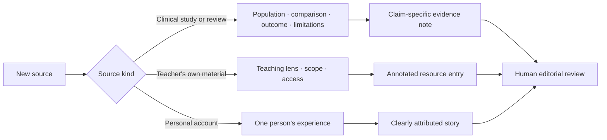

# Research & people: a nervous-system field guide 🔎

**Reviewed:** October 10, 2026. **Purpose:** editorial research for [exploration 0010](../explorations/0010_%5B_%5D_A_LITTLE_MORE_ROOM_NERVOUS_SYSTEM_SITE_REJUVENATION.md). These are source notes and proposed editorial judgments, not individualized treatment advice or a systematic review.

## How this research was done

Searches covered PubMed/PMC and journal sites for 2025–2026 work on somatic approaches, PTSD, interoception, autistic burnout, breathwork, IFS, neurofeedback, and polyvagal theory. Older guidelines, trials, and reviews were retained where they provide useful context. Official practitioner sites were used to identify their offerings and language, **not to validate their effectiveness**. Public pages and the repository were reviewed on the date above.

Representative search families: `PTSD somatic experiencing 2025 2026 randomized`, `interoception autism systematic review 2025`, `autistic burnout 2025 systematic review`, `polyvagal 2026 Grossman Porges`, `internal family systems PTSD randomized 2026`, `neurofeedback PTSD meta analysis 2025`, `hyperbaric oxygen PTSD randomized trial`, and official-site searches for the named teachers. This was a targeted editorial scan, not an exhaustive database export or formal risk-of-bias assessment. Abstract-only conclusions are identified below. Publication dates come from article records rather than search-engine crawl dates.

## Evidence ledger

The editorial categories below describe a **specific claim and outcome**. They are not a ranking of people, a formal GRADE assessment, or a promise that an approach will suit an individual.

| ID | Source / date / access reviewed | What it contributes | Limitation and site decision |
|---|---|---|---|
| R01 | [VA National Center for PTSD: psychotherapy overview](https://www.ptsd.va.gov/professional/treat/txessentials/overview_therapy.asp), current page describing the 2023 VA/DoD guideline; guideline summary read | CPT, PE, and EMDR are the principal recommended trauma-focused psychotherapies for PTSD. | **Established for PTSD**, not evidence for treating every kind of burnout or distress. Add CPT and PE to a directory currently tilted toward somatic and substance approaches. Choice and access still matter. |
| R02 | [Lehmivaara et al., SE-derived intervention](https://www.tandfonline.com/doi/full/10.1080/20008066.2026.2613544), online January 26, 2026; full article reviewed | Two experiments (n=89 and n=55) compared a brief practitioner-delivered intervention with psychoeducation. Immediate felt-safety/body-boundary outcomes favored the intervention. | **Promising, narrow outcomes.** HR/HRV changed across groups, so these physiological results do not establish a specific SE effect. No demonstration of durable PTSD recovery or of this website's micro-practices. Study II included a participant who stopped after becoming sad when invited to notice sensations. Body focus remains optional. The December volume date is not a future publication: the article was available in January. |
| R03 | [Joss et al., PARTS IFS trial](https://pubmed.ncbi.nlm.nih.gov/41609644/), January 29, 2026; abstract reviewed | Sixty people randomized to PARTS or an active nature-based comparison; both arms included group sessions and individual counseling. Both improved on PTSD severity; PARTS had better attendance and satisfaction. | **Preliminary.** No significant between-group difference in PTSD improvement. Do not say this proves IFS superior, equivalent, or ineffective. Add this result to the existing IFS entry; avoid relying on an old registry listing as a current endorsement. |
| R04 | [Sinnott et al., yoga and PTSD symptom clusters](https://pmc.ncbi.nlm.nih.gov/articles/PMC13044381/), online January 16, 2026; indexed article excerpts reviewed, full retrieval intermittent | A randomized-trial synthesis reports benefit for some PTSD outcomes, including intrusion and total symptoms, with substantial risk-of-bias concerns. | **Promising adjunctive evidence.** Yoga variants and comparisons differ; this does not validate every online yoga class, or show equivalence to first-line care. Recheck full tables before publishing numerical effects. |
| R05 | [Kuhfuß et al., SE scoping review](https://pmc.ncbi.nlm.nih.gov/articles/PMC8276649/), July 12, 2021; full-text source reviewed | Sixteen included studies provided preliminary evidence, with mixed study quality. | Useful historical baseline for R02. New work should update this story, not erase the remaining uncertainty. SE's explanatory framework and its clinical outcomes are separate questions. |
| R06 | [Fincham et al., breathwork meta-analysis](https://www.nature.com/articles/s41598-022-27247-y), January 9, 2023; full-text source reviewed | Twelve stress-outcome RCTs with 785 adults found a small-to-medium average reduction in self-reported stress, with most studies at moderate risk of bias. | **Some support for stress reduction**, not proof of trauma release, a permanent reset, or an optimal universal breathing ratio. Do not transfer results directly to a 30-second site interaction. |
| R07 | [Fincham et al., high-ventilation breathwork trial](https://pubmed.ncbi.nlm.nih.gov/39043650/), 2024; abstract reviewed | A blinded study of 200 young healthy adults found no significant primary stress advantage of high-ventilation breathwork with retention over its comparison intervention. | **Mixed result; specific population.** More intensity does not earn a more prominent beginner recommendation. Keep hyperventilation and prolonged breath-hold protocols out of the self-guided welcome path. |
| R08 | [Autism and interoception review](https://www.frontiersin.org/journals/psychiatry/articles/10.3389/fpsyt.2025.1573263/full), 2025; abstract and full-text source consulted | Thirty-one studies showed heterogeneous findings; the five-study adult cardiac-accuracy meta-analysis found no statistically significant group difference. | **Heterogeneous, measurement-dependent.** Avoid a universal “autistic people cannot read their bodies” narrative. Distinguish accuracy, subjective sensitivity, and awareness; allow “I don't know,” outside anchors, and no body focus. |
| R09 | [Ali et al., autistic burnout systematic review](https://pubmed.ncbi.nlm.nih.gov/41207162/), online November 4, 2025; abstract reviewed | Forty-eight studies involving roughly 4,000 people connect burnout with demands, masking, overwhelm, and social context. Reported recovery supports include rest, sensory relief, understanding, and community. | Mostly qualitative/mixed evidence with demographic limitations. **Context and lived-experience synthesis**, not a trial establishing that rest alone treats burnout. Give accommodations and practical support as much space as exercises. |
| R10 | [Grossman et al., polyvagal critique](https://pubmed.ncbi.nlm.nih.gov/41768017/), February 2026; abstract reviewed | A multi-author appraisal challenges foundational anatomical, evolutionary, and measurement claims. | **Substantial scientific dispute.** Do not infer a person's vagal pathway from two sliders, or treat HRV as a direct score of safety or healing. |
| R11 | [Porges's response](https://pubmed.ncbi.nlm.nih.gov/41768026/), February 2026; abstract reviewed | Porges argues that the critique misrepresents the theory's level of explanation and claims. | Present the disagreement accurately without implying it has been resolved or that two position papers imply equal evidentiary support. Use everyday experience language before named neurophysiological theories. |
| R12 | [Doenyas-Barak et al., HBOT RCT](https://www.psychiatrist.com/jcp/hyperbaric-oxygen-therapy-controlled-trial-veterans-ptsd/), November 2024; article abstract and methods/results excerpts reviewed | Sixty-three male veterans randomized; 56 completed. A multi-session clinical protocol showed PTSD improvement relative to sham. | **Emerging, population-specific.** This is not evidence of a one-session reset, general treatment for autistic burnout, or the mechanism of Chris's experience. If included, put HBOT in a research note with clinician context, not the beginner menu. |
| R13 | [Berman et al., neurofeedback meta-analysis](https://pubmed.ncbi.nlm.nih.gov/41415692/), December 3, 2025; abstract reviewed | EEG studies looked more favorable against passive controls; sham-controlled fMRI studies did not show PTSD improvement. Authors rated confidence very low to low. | **Experimental/uncertain.** Control-group design matters. Do not generalize between EEG, fMRI, or consumer devices; none of these findings creates a reason to buy a device through this site. |
| R14 | [Ayudia et al., culturally adapted SE trial protocol](https://pubmed.ncbi.nlm.nih.gov/41428713/), December 22, 2025; abstract reviewed | A planned randomized study adapts a group intervention for Indonesian women who survived sexual assault. | **Protocol, not results.** Worth following for cultural applicability; cannot be cited as evidence that the intervention works. |
| R15 | [Lanius et al., dissociative subtype](https://pubmed.ncbi.nlm.nih.gov/20360318/), 2010; abstract reviewed | A clinical/neurobiological account distinguishes dissociative presentations from predominantly hyperaroused PTSD. | **Clinical background**, not a website screening instrument. Quiet appearance cannot establish comfort or identify the cause of low energy. |

### What “latest” should mean on the site

A recent null finding belongs beside a recent positive finding. A trial protocol belongs under “being studied,” not “shown to help.” A teacher's refreshed homepage is not a new clinical study. A date badge should mean someone checked the specific claims and sources.

Use a compact evidence note with four fields: **what was studied; what was found; what remains uncertain; why it matters here**. Link to the original source and carry the review date. Keep effects, mechanisms, testimonials, and metaphors distinct.

## People worth meeting, with a reason to meet them 🌱

The first four respond directly to the request. “Johnny Miller” is spelled **Jonny Miller** on his own site. Chris confirmed that **Bessel van der Kolk** was the fourth person intended. These are candidates for an annotated directory, not endorsements, credential audits, or a claim that all are clinical researchers. Access descriptions reflect visible public pages; nothing was purchased or submitted.

| Person / role in this guide | Distinct contribution | A concrete way in | Editorial boundary / access |
|---|---|---|---|
| **Irene Lyon — somatic educator** | Patient noticing, orienting, learning gradually; a direct influence named by Chris | [Neurosensory exercises explainer](https://irenelyon.com/2021/09/12/neurosensory-exercises-the-practical-side-of-my-work/) and [resource center](https://irenelyon.com/free-resources/) | Public article plus free downloads and paid programs. Verify each download's signup gate individually. Her blend of SE, Feldenkrais, and other influences is an educational offering; trials of those ingredients do not establish efficacy of her whole course. |
| **Joe Hudson — coach / Art of Accomplishment** | Curiosity about feelings, vulnerability, interpersonal connection, permission to enjoy life | [Fear of being seen episode](https://www.artofaccomplishment.com/podcast/whats-beneath-your-fear-of-being-seen---coaching-with-joe); [podcast index](https://www.artofaccomplishment.com/podcast) | Public episode page; the [experiments toolkit](https://www.artofaccomplishment.com/resources/experiments) asks for email. Coaching and emotional exploration are not established PTSD treatment. Do not convert “feel it fully” into a universal instruction to stay with overwhelming sensations. |
| **Jonny Miller — educator / Nervous System Mastery** | Readable practices, interoception, emotional flexibility, and environmental changes | [Topic hubs](https://www.nsmastery.com/topics) and [literature collection](https://www.nsmastery.com/literature) | Public reading, alongside a paid cohort and products. His study list is useful for discovery, not independent validation of the program. Avoid copying mastery deadlines, performance language, or using HRV as the visitor's score. |
| **Bessel van der Kolk — psychiatrist / trauma researcher** | A bridge into trauma's effects on experience, relationships, and the body | [Trauma Research Foundation resources](https://traumaresearchfoundation.org/resources/) and [foundational research](https://traumaresearchfoundation.org/foundational-research/) | Public research/resource pages; books and training also exist. Offer a short introduction before a book with difficult case material. Assess each treatment on its own evidence; a famous name does not validate a whole modality. |
| **Peter Levine — developer of Somatic Experiencing** | The vocabulary of titration, pendulation, and resources | [SE International: SE 101](https://traumahealing.org/se-101/) | Public introduction. Explain “stored survival energy” as the approach's model; do not assert it is a measured substance in muscles. Pair with R02/R05. |
| **Deb Dana — clinician / polyvagal educator** | Approachable language for small moments of ease, everyday state awareness, connection | [Rhythm of Regulation media library](https://www.rhythmofregulation.com/media-library) | Public resource directory. “Glimmers” can be a useful invitation without establishing ventral/dorsal diagnostic categories. Read alongside R10/R11. |
| **Janina Fisher — trauma clinician / author** | A compassionate way to understand protective reactions and inner conflict | [Resources](https://janinafisher.com/resources/) | Mix of public articles/videos and paid books; the separate [ebook library](https://janinafisher.com/resources/ebooks/) uses forms. Much material addresses clinicians. Mark audience; do not turn clinical protocols into beginner DIY exercises. |
| **David Treleaven — trauma-sensitive mindfulness educator** | Why the option to change an anchor, open eyes, move, or stop belongs in every practice | [Trauma-sensitive mindfulness introduction](https://davidtreleaven.com/home/) | Public introduction and signup-based webinar/training. A practical design influence; no claim that his training has established independent clinical efficacy. |
| **Kelly Mahler — occupational therapist / interoception educator** | Concrete, curious, neurodivergence-aware ways to explore signals without testing someone for a “correct” feeling | [Free interoception videos](https://www.kelly-mahler.com/interoception-videos/) and [self-help resources](https://www.kelly-mahler.com/interoception-for-self-helpers/) | Public video library, with paid curricula and signup-gated printables elsewhere. Check whether each resource is for children, adults, caregivers, or practitioners. Do not assume pediatric curriculum results generalize to adults. |
| **Resmaa Menakem — somatic author / educator** | Racialized experience, collective context, relationship and culture beyond individual self-regulation | [Resources](https://resmaa.com/resources/) and [learning options](https://resmaa.com/learning-options/) | Public interviews plus paid offerings. Treat cultural and historical framing respectfully; avoid reducing racism to an individual's state or making unsupported inherited-biological-trauma claims. |
| **Ruth Lanius — psychiatrist / researcher** | Dissociation, brain-body experience, and the limits of interpreting visible calm | [Research and education](https://www.ruthlanius.com/); R15 for background | More technical and clinician-facing. Use as a research bridge with a plain-language summary, not the default first stop. Neuroimaging does not diagnose a reader. |

### Broaden the circle beyond well-known teachers

Feature **Dora Raymaker and autistic-led research**, **Marylène Cloitre and Monique Pfaltz** (coauthors on R02), and **Diane Joss / Zev Schuman-Olivier's group** (R03) within research stories. Include the patient-facing [VA PTSD treatment decision aid](https://www.ptsd.va.gov/apps/decisionaid/) as a resource beside personality-led material. The site should help someone find questions and support, not choose an authority to follow.

The original [Raymaker et al. burnout study](https://pubmed.ncbi.nlm.nih.gov/32851204/) is linked by Chris's essay; R09 broadens this line of inquiry. Its participants' recovery accounts should not be described as a clinical trial of reclining or stillness.

### Proposed directory card

> **Joe Hudson · Meeting feelings with curiosity**  
> Coach and cohost of Art of Accomplishment. A possible way in if you are curious about vulnerability, connection, and how you relate to emotions.  
> **Start with:** one public episode on being seen.  
> **What this is:** a coaching conversation. **What it establishes:** an illustration of an approach, not clinical efficacy.  
> **Access:** episode page available publicly; other materials may require email or payment.  
> **Your choice:** listening is enough. You do not need to try an exercise or finish the episode.

Avoid fabricated quotes, invented professional licenses, course-result statistics without independent context, copied exercises, or implied endorsement from the people listed. Prefer text-first cards and links over scraped portraits, embedded trackers, or a wall of authority badges.

## The founder's public material

- [October 9, 2026 X post](https://x.com/becomingbabyman/status/2108715333494411314): read in the browser after the web reader returned 403. Chris describes a felt change after a first HBOT experience and asks what to do with intense returning sensation. This is personal sequence and interpretation, not a causal study. The practical editorial question is how to welcome someone feeling too much, not how to reproduce an intervention.
- [Timeout](https://xnet.fyi/blog/timeout/): read in full. The themes relevant to the website are permission to pause, reconnection, and a life that can include absence. Preserve the literary voice while keeping physiological interpretations in a separate evidence note.
- [crs.coach](https://crs.coach/): read in the browser. It offers a model of direct, warm presence and explicitly identifies coaching as distinct from therapy. The healing site can acknowledge the author and link from About while keeping educational routes independent of booking.
- [crs.garden](https://crs.garden/): the visible collection includes Joe Hudson pieces on authority and being seen. This supports making emotional and relational curiosity part of the site, alongside physiological vocabulary.

## Publication checks

- [x] Separate primary research from provider descriptions and personal accounts.
- [x] Include positive, null, contested, and protocol-only findings.
- [x] Preserve population and outcome limitations.
- [x] Verify the tweet text through an accessible browser page.
- [ ] Verify full paper details for any quantitative public-facing claim derived only from an abstract or excerpt.
- [ ] Have clinical material reviewed by an appropriately qualified reader before releasing the overhaul.
- [ ] Review each outbound resource's access barrier, intended audience, and current destination as it is added.
- [ ] Recheck medical/legal details on existing substance pages individually; this scan does not refresh those entries.
